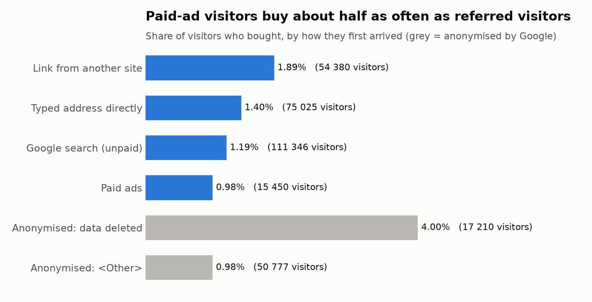
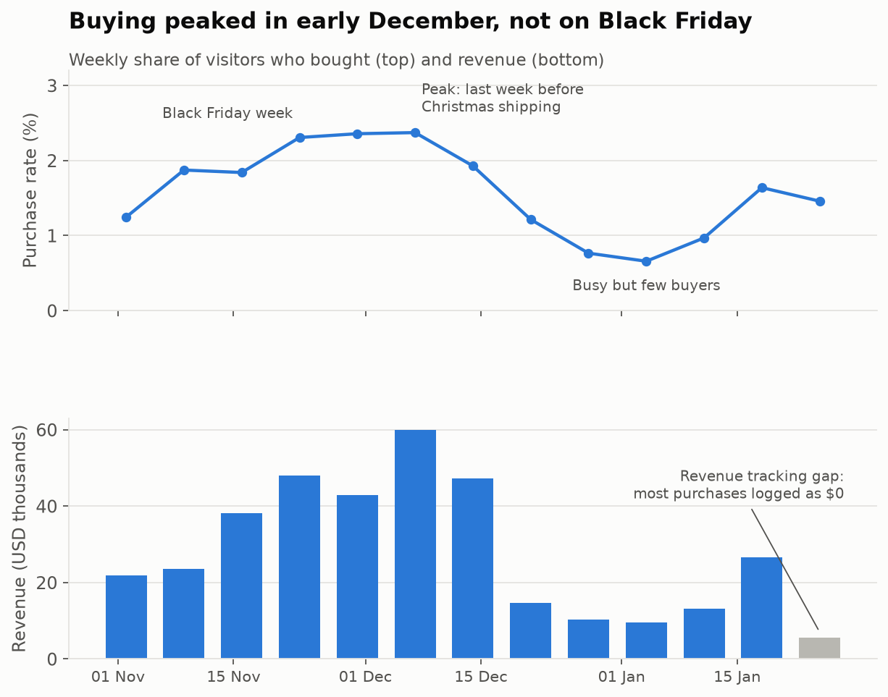

Getting people to visit an online shop is one thing. Turning them into paying customers is another. The useful question is *where* potential customers drop out of the buying process. Is it when they first land on the website, when they look at a product, or halfway through checkout? Each answer points to a different fix.

To find out, I analysed three months of data (1 November 2020 to 31 January 2021) from the **Google Merchandise Store**, the online shop that sells Google-branded hoodies, mugs and stickers. Google makes a sample of this shop's data publicly available in **Google BigQuery**, its cloud database. The data was collected through **Google Analytics 4 (GA4)**, the tool many online shops use to track what visitors do on their website. I used **SQL (Structured Query Language)**, the standard language for asking questions of a database, to analyse it.

## How online shops track the buying journey

GA4 records every action a visitor takes as an **event**. Lined up in order, the key events form a **funnel**: wide at the top, because everyone who visits is counted, and narrow at the bottom, because only a few people buy. I used six events as the six steps of my funnel:

| Funnel step | GA4 event |
|---|---|
| Visited the shop | `session_start` |
| Viewed a product | `view_item` |
| Added to cart | `add_to_cart` |
| Started checkout | `begin_checkout` |
| Entered payment details | `add_payment_info` |
| Bought | `purchase` |

A **visitor** here is one anonymous ID that GA4 gives each browser. For each step, I counted how many different visitors did it at least once in the three months. I then worked out two kinds of rate: the share of visitors who moved on from one step to the next, and the share of all visitors who eventually bought.

One simplification is worth knowing. I counted each step separately, so the funnel does not check that a visitor did the steps in order or in the same visit. That is fine for a first overview, and I explain how I would make it stricter under *What I would do next*.

I then compared these numbers by device, by how visitors first arrived at the shop, and week by week.

## Key findings

**Most visitors leave long before checkout.** Of the 267 116 visitors, 23% viewed at least one product. Of those who viewed a product, 20% added something to their cart. Overall, 1.65% of all visitors bought something, which is within the typical range for online shops (roughly 1% to 3%).

**Once people add something to their cart, most go on to start checkout.** 77% of visitors who added an item to their cart started checkout.

**The biggest drop-off inside checkout is at the payment step.** Of the 9 715 visitors who started checkout, 5 751 went on to enter their payment details. About 3 960 people (41%) stopped at this point. The data does not say why. Shipping costs or other unexpected charges often first appear at this stage, so they could be part of the reason. That makes this step a good candidate for further investigation and an A/B test (see *What I would do next*).

**There is no clear difference between mobile and desktop.** 1.71% of the 107 981 mobile visitors bought something, compared with 1.62% of the 157 079 desktop visitors. Small gaps like this can appear by chance, so I used a **two-proportion z-test**, a standard test for comparing two percentages. It gave a **p-value** of 0.056: the probability of seeing a gap at least this big if there were no real difference. Analysts usually require a p-value below 0.05 before calling a difference real, so there was no statistically significant difference between mobile and desktop.

**Visitors who first arrived through paid ads were the least likely to buy.** GA4 records how each visitor first arrived at the shop: through a link on another website, by typing the address, through an unpaid Google search result, or by clicking a paid ad. Of the visitors whose first visit came from a paid ad, 0.98% bought something. That is about half the rate of visitors who first arrived through a link on another website (1.89%), and lower than unpaid search (1.19%) or typing the address (1.40%).

Two cautions apply. First, GA4 gives each visitor the source of their *first* visit only, so someone who first clicked an ad and later came back through Google search still counts as an ad visitor. Google has also anonymised the source for about a fifth of visitors, shown in grey in the chart. Second, a purchase rate does not show whether a source is worth paying for. The shop pays for every ad click, but the dataset does not include those costs. The analysis can show *how often* ad visitors buy, but not *whether the ads pay for themselves*.

**Sales peaked in early December, not in the Black Friday week.** The week starting 7 December had the most visitors (31 083), buyers (737) and revenue. One possible explanation is that it was the last week to order in time for Christmas delivery, although the data cannot confirm this. After 21 December, sales fell sharply. Early January is the most puzzling period: in the week starting 4 January, the shop had about four in five as many visitors as in the peak week (24 493), but less than a quarter of the buyers (161).

## A tracking error, not a sales drop

In the last week of January, the average amount spent per buyer fell to about US$18. In every earlier week, it was between about US$60 and US$105. Before reporting this as a finding, I checked the data day by day.

The number of purchases stayed within its usual range, at about 20 to 100 a day. What changed was how they were recorded. Up to 25 January, only a small share of purchases (4% to 13% a day) had a value of US$0, which is normal for free or fully discounted orders. From 26 January, that share rose quickly:

| Date | Purchases recorded as US$0 |
|---|---|
| 18–25 January | 4% to 13% |
| 26 January | 60% |
| 28 January | 93% |
| 31 January | 100% |

The shop did not suddenly start giving its products away. People were still buying, but the tracking stopped recording how much they paid. So the purchase counts for those days are still reliable, but the revenue figures are not.

I handled this in two ways. I kept the purchase counts and purchase rates for those days, because they were not affected. I left the revenue for 26 to 31 January out of my conclusions, and the weekly chart shows that week's revenue in grey. None of the findings above rely on revenue from that period.

## What I would do next

**1. Track each visitor's journey step by step to find exactly where they drop out.** At the moment, a visitor counts as "added to cart" if they did it at any point in the three months, even if they never viewed a product beforehand, or did so in a different visit. A stricter funnel would follow each visit and only count a step if the previous step happened first, in the same visit. In SQL, this means finding the time each visitor first reached each step and checking that the times are in the right order. This would give more accurate drop-off rates, and would also show how long people take between steps.

**2. Combine advertising costs with sales data to see whether the ads pay for themselves.** With the shop's ad spend, I could calculate two standard measures for each traffic source:

- **Cost per acquisition:** ad spend divided by the number of purchases from ad visitors. For example, if 15 000 ad clicks cost US$7 500 (US$0.50 a click) and produced 150 purchases, each purchase cost US$50 to win.
- **Return on ad spend:** revenue from ad visitors divided by ad spend. If those 150 purchases averaged US$75, they brought in US$11 250, or US$1.50 for every US$1 spent on ads. At US$2 a click, the same purchases would cost US$30 000, and the shop would get back only about US$0.38 for every US$1.

*(These costs are made-up examples; the dataset does not include ad spend.)* Whether a given return is good enough also depends on the shop's profit margins. This would turn "ad visitors buy less often" into an answer to the question a business actually cares about: should we keep paying for these ads?

**3. Test whether showing shipping costs earlier improves checkout completion.** An **A/B test** shows two versions of a page to two randomly chosen groups of visitors at the same time, and compares the results.

- **Version A (current):** shipping costs appear at the payment step.
- **Version B (test):** shipping costs are shown on the cart page, before checkout starts.
- **Main measure:** the share of people who start checkout and go on to buy. Currently this is about 45%.
- **Size of the test:** decide in advance how big an improvement is worth detecting. To reliably detect an increase from 45% to 48%, each version needs about 4 300 checkout visitors. At this shop's traffic, that would take roughly three months.
- **Deciding the winner:** when the planned number of visitors is reached, compare the two purchase rates with the same two-proportion z-test I used for mobile and desktop. Version B wins only if its rate is higher and the p-value is below 0.05.
- **Side effects to watch:** showing shipping costs earlier could put some people off adding items to their cart at all. So I would also check that the overall share of visitors who buy does not fall.

## Tools and techniques

- **SQL in Google BigQuery:** all data extraction and analysis, including counting visitors at each step, splitting the results by device, traffic source and week, and the day-by-day revenue check.
- **Python:** the significance test and the charts.
- **Techniques:** funnel analysis, conversion rate analysis, segmentation, trend analysis, statistical testing and data quality checks.

The SQL queries, results and charts are in the [GitHub repository](https://github.com/maytarr/ecommerce-funnel-analysis).
